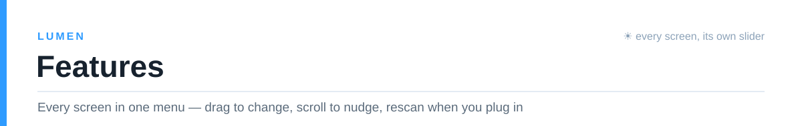
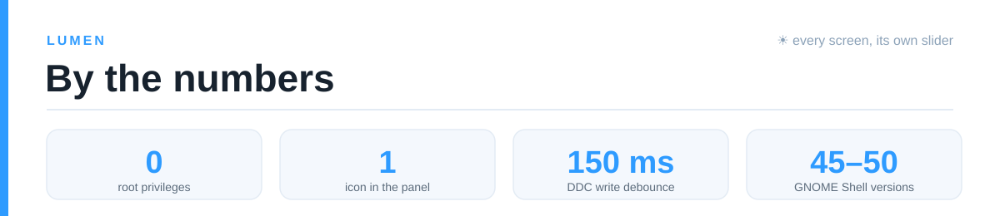
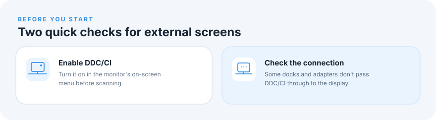

<div align="center">


# Lumen

**Per-display brightness controls for GNOME Shell.** Adjust a built-in laptop display and external DDC/CI monitors from the top panel.


<br>



<a href="#install"></a>&nbsp;&nbsp;<a href="#install"></a>&nbsp;&nbsp;<a href="https://github.com/sailxx/lumen/releases/latest"></a>

</div>

<br>



<details>
<summary><b>More about the features</b></summary>

### Independent display controls

Each detected display gets its own brightness slider. Lumen uses the system backlight interface through logind for a built-in laptop display, and `ddcutil` over DDC/CI for external monitors. Current brightness is read from the display; unavailable readings are shown as unavailable instead of being replaced with a guessed value.

### Panel scrolling

Scroll over a display row to adjust that display. Scroll over the panel icon to adjust the last-used display. The step size is configurable from 1% to 25%, with 5% as the default. Writes are briefly debounced to avoid sending a command for every wheel tick.

### Connect and refresh

Lumen refreshes values when its menu opens and can rescan after a display is connected or disconnected. Use **Refresh displays** in the menu to request a new scan.

### No background service

Lumen runs as a GNOME Shell extension. It has no background daemon and makes no network connections. External display access may require a one-time system setup for `ddcutil`, the `i2c-dev` module and active-session device permissions. Brightness changes run in the logged-in session.

</details>

<br>



<br>



<br>



<details>
<a id="install"></a>

<summary><b>Install</b></summary>

### Linux setup

The setup script supports Fedora (`dnf`), Debian/Ubuntu (`apt-get`), Arch Linux (`pacman`) and openSUSE (`zypper`). It installs `ddcutil` and `i2c-tools`, enables `i2c-dev`, and configures active-session access to I2C devices if the system has no ddcutil udev rule. Review the script before running it.

```bash
git clone https://github.com/sailxx/lumen.git
cd lumen
./setup-monitor-brightness.sh
```

Sign out and back in so the device permissions apply. Then install the extension archive from a GNOME session:

```bash
sudo dnf install zip glib2-devel   # Fedora, if the packaging tools are missing
cd extension
./install.sh
```

Restart GNOME Shell, then enable Lumen:

```bash
gnome-extensions enable lumen@vlad
```

On Wayland, sign out and back in to restart GNOME Shell. On X11, press `Alt`+`F2`, enter `r`, and press Enter.

### Fedora RPM

```bash
sudo dnf install rpm-build
git clone https://github.com/sailxx/lumen.git
cd lumen/rpm
./build-rpm.sh
sudo dnf install rpmbuild/RPMS/noarch/gnome-shell-extension-lumen-*.rpm
gnome-extensions enable lumen@vlad
```

The RPM installs the extension and schema system-wide, adds the udev rule and loads `i2c-dev` at boot. Restart GNOME Shell after installation.

</details>

<details>
<summary><b>Requirements and known limits</b></summary>

- Linux with GNOME Shell 45–50.
- `ddcutil` 1.4 or later and `i2c-tools` for external monitors.
- A DDC/CI-capable monitor with DDC/CI enabled in its on-screen settings.
- `zip` and `glib-compile-schemas` to build a local installation archive.
- Built-in backlight control requires a device under `/sys/class/backlight` and permission from logind for the current session.

Some docks and adapters do not pass DDC/CI reliably. Certain NVIDIA driver setups may require `nvidia-drm.modeset=1`; follow your distribution's instructions for changing kernel arguments.

| Symptom | Check |
|---|---|
| An external display is missing | Enable DDC/CI in the monitor menu, run `ddcutil detect`, then choose **Refresh displays**. |
| `ddcutil` reports permission denied | Sign out and back in after setup so active-session permissions take effect. |
| The slider is unavailable | Check DDC/CI and run `ddcutil getvcp 10` to see whether the monitor reports brightness. |
| A monitor is connected through a dock | Reconnect it and scan again; some docks do not pass DDC/CI. |

Useful diagnostics:

```bash
ddcutil environment
ddcutil detect
journalctl --user -b _COMM=gnome-shell | grep -i lumen
```

</details>

<details>
<summary><b>Use and uninstall</b></summary>

Open the sun icon in the GNOME top panel. Move a display's slider to change its brightness. Scroll over a row to adjust that display, or scroll over the panel icon to adjust the last-used display. Open **Preferences** to show or hide the built-in display and change the scroll step.

For an RPM installation:

```bash
sudo dnf remove gnome-shell-extension-lumen
```

For a zip installation:

```bash
gnome-extensions disable lumen@vlad
rm -rf ~/.local/share/gnome-shell/extensions/lumen@vlad
```

If setup created `/etc/modules-load.d/lumen-i2c-dev.conf` or `/etc/udev/rules.d/60-monitor-brightness-i2c.rules`, remove those files to undo the corresponding system configuration, then reload udev rules.

</details>

<details>
<summary><b>Development</b></summary>

```text
extension/   GNOME Shell extension, preferences, schema, and zip packager
rpm/         RPM spec, build script, udev rule, and module-load configuration
assets/      Logo and README artwork
docs/        Project design and implementation records
```

Build a local extension archive with `extension/package.sh`. Build the Fedora RPM with `rpm/build-rpm.sh`. The project license is MIT.

</details>

<div align="center">

**Lumen** — every display, its own brightness control.

</div>
